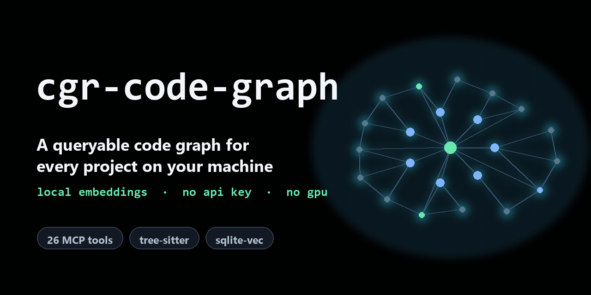

# cgr-code-graph

[](https://github.com/naelrudd/cgr-code-graph/actions/workflows/ci.yml)
[](LICENSE)
[](#requirements)
[](https://github.com/vitali87/code-graph-rag)



Turn a multi-project drive or monorepo into a queryable code graph — **local
embeddings, no API key, no Docker, no Java, no GPU**.

An installer, a preflight check and a skill pack for
[`code-graph-rag`](https://github.com/vitali87/code-graph-rag) (`cgr`), tuned for
the case upstream does not cover: one workspace spanning ~20 unrelated projects
on one machine, indexed overnight, queried by agents through MCP.

```text
  your drive                    cgr, entirely local                your agent
  ──────────                    ───────────────────                ──────────
  20 projects   ──parse──▶  graph.sqlite   (nodes + edges)
               tree-sitter  vectors.sqlite (sqlite-vec)  ──MCP──▶  semantic_search
               + UniXcoder                                  stdio   callers · importers
               (768-d, CPU)                                         find_duplicate_code
                                                                    endpoints · ask_agent
```

Nothing leaves the machine: a sync is local parsing plus a local embedding model.
An LLM endpoint is optional and only used by `ask_agent`.

## Contents

- [Quick start](#quick-start)
- [What you get](#what-you-get)
- [One root, or one project per repo](#one-root-or-one-project-per-repo)
- [Measured, not promised](#measured-not-promised)
- [Three usage layers](#three-usage-layers)
- [Requirements](#requirements)
- [When not to use this](#when-not-to-use-this)
- [Troubleshooting](#troubleshooting)
- [Docs](#docs)
- [Security](#security)
- [Contributing](#contributing)
- [Credit](#credit)

## Quick start

```bash
git clone https://github.com/naelrudd/cgr-code-graph
cd cgr-code-graph

bash scripts/install.sh                       # uv tool + the httpx the wheel omits + torch/transformers
bash scripts/doctor.sh D:/work                # preflight: fail here, not 40 minutes into a sync
bash scripts/init-workspace.sh work D:/work   # detect projects, register them, start indexing
bash scripts/register-mcp.sh work D:/work     # make it automatic (Hermes shown; any MCP client works)
bash scripts/register-mcp.sh work D:/work --with-writer   # + a server that can write notes
bash scripts/refresh.sh work                  # later: incremental re-sync, seconds
bash scripts/ask.sh work "where is X built?"  # one question, no agent session
```

`init-workspace.sh` defaults to **one project per repo** under the root. Add
`--root` to index the root itself as a single project instead — read
[One root, or one project per repo](#one-root-or-one-project-per-repo) before
choosing, because it decides whether cross-package imports resolve.

PowerShell: `pwsh -File scripts/install.ps1` covers the install half; the other
scripts run under git-bash or WSL.

Two things the first run will show, both expected:

- `Warning: You are sending unauthenticated requests to the HF Hub` — the model is
  being downloaded anonymously. It still works; a read token only raises rate
  limits. `bash scripts/hf-login.sh` handles that safely, or ignore it.
- A first full pass takes hours on a large corpus: it is CPU-bound on the
  embedding model (~1.1 functions/s measured). Run it as a tracked background
  job, and check progress with `select count(*) from cgr_nodes` in
  `~/.cgr/graph.sqlite` rather than by watching the log.

## What you get

The MCP server exposes **26 read-only tools** (cgr 0.5.0). The ones that change
how an agent works:

| tool | why it matters |
| --- | --- |
| `semantic_search` | natural-language query over every function in every project |
| `get_code_snippet` / `get_function_source` | exact source for a hit, by qualified name |
| `callers` / `importers` | who calls this, what this imports — across project boundaries |
| `find_duplicate_code` | structural duplicates; the thing `grep` cannot find |
| `endpoints` | HTTP surface inventory |
| `ask_agent` | the whole graph as a chat target (needs an LLM endpoint) |
| `explain_traceback` / `rank_root_causes` | traceback → graph correlation |
| `flow_verdict` | source-to-sink reachability for a sanitizer question |

### Notes that stick to the code

`--read-only` also hides the writing half: **26 of 37 tools**. Among the missing
eleven is `annotate`, the only way an agent can leave a note behind — and a note
is how the *why* survives the session that produced it.

`scripts/register-mcp.sh <workspace> <root> --with-writer` adds a second server,
`cgr-write`, with the flag dropped. Same graph, same env, minus `MCP_READ_ONLY`
(the env var alone re-arms the gate). Opt-in because the other writers —
`rename`, `write_file`, `wipe_database` — come along with it.

A gloss is a node, not a comment:

```
qualified_name : gloss:712af35dc16004482b12e2cf
kind           : invariant          (invariant | mirrors | platform-conditional | safety-precondition)
anchor_state   : EXACT              (re-graded each sync: MOVED survives a rename, LOST means gone)
target_hash    : ah1:c0f8b934...b608f6
commit_sha     : 4d46bdf8...
   ANNOTATES ──▶ nael-algorithms__aa1801f9.exercises.binary_search.solution.binary_search
```

That fingerprinting is the reason to prefer this over a markdown link to a line
number: the link rots silently, the gloss is re-anchored. The limit is the shape —
four `kind` values fit engineering constraints, not free prose, and notes are read
per target (`glosses <qualified name>`), so there is no "search all notes". Those
belong in a vault; this belongs next to the function.

## One root, or one project per repo

Imports and calls are resolved **by path against the root you indexed**, so this
choice decides what the graph can see:

```bash
bash scripts/init-workspace.sh work D:/work            # one project per repo (default)
bash scripts/init-workspace.sh work D:/packages --root  # the whole root as one project
```

Measured on a two-package corpus (4 files, `--no-embeddings`): one Python absolute
import and one JS relative import, each crossing the package boundary.

| indexed as | import edge | call edge |
| --- | --- | --- |
| root itself (`--root`) | `IMPORTS -> [Module] e2e.pkg_b.core` | `CALLS e2e.pkg_a.app.run -> e2e.pkg_b.core.helper` |
| two projects | `IMPORTS -> [ExternalModule] pkg_b.core` | none — the call edge does not exist |

The JavaScript pair behaves the same way (`Module` + `CALLS` under one root,
`ExternalModule` and no call edge under two). 18 edges indexed as one root, 14 as
two projects: the four that vanish are the two imports and the two calls that
crossed the package boundary.

So an unreferenced-looking function in a monorepo, a workspace, or a parent
directory holding several packages is usually an indexing decision, not a
limitation. `--root` costs you one namespace: a single hash cache, `--clean`
wipes everything, and there is no per-repo refresh or per-repo file counts.

Merge only where the repos genuinely import each other by path. Two projects that
each depend on `lodash` gain nothing from sharing a root.

The root is registered under the name cgr derives from the folder
(`nael-algorithms__aa1801f9`), the same way a child repo would be, so the workspace
file, the graph project and the hash cache under `~/.cgr/state/` all agree.

Changing an existing workspace's layout is refused, because
`workspace create --force` replaces the definition while the projects the old
layout indexed stay in the graph — every file would then answer twice under two
namespaces. Pass `--force` once you accept that, or use a second workspace name:

```bash
bash scripts/init-workspace.sh work D:/work --root --force
```

## Did everything actually land?

A sync that dies, or a repo written in a language cgr has no grammar for, still
leaves a hash cache under `~/.cgr/state/<project>/`. That folder proves a sync was
*attempted*. To see what the graph really holds, read the graph:

```bash
python3 scripts/audit-workspace.py work
CGR_HOME=D:/other-graph python3 scripts/audit-workspace.py work   # a different graph home
```

```
project                       nodes   defs  files   edges
ngapal__1c96cb4c                295    245     23     966
skripsi__fc42227f             10765   3923   5548   15969

A LANGUAGE cgr HAS NO PARSER FOR (indexed as files only, no code graph):
  peeler__6b6a6249             19 files (.astro): nothing to query here

declared: 21  with nodes: 21  missing: 0
```

Exit status is 1 only when a declared repo has **no nodes at all** — the one
verdict that means the sync produced nothing. The other verdicts are information:

| verdict | meaning | what to do |
| --- | --- | --- |
| no nodes at all | the sync never ran, or wrote nothing | run `index.sh` again for that repo |
| code but no definitions | files landed, contents did not | re-run its sync; a stopped run does this |
| a language cgr has no parser for | `.astro`, `.vue`, `.svelte`, … land as files only | nothing — such repos are not queryable by code |
| nothing to parse | docs/config only | nothing — expected |

`cgr stats` also lists nodes and relationships per project, and
`cgr delete-project --project <name>` removes one project from the graph without
touching the others (useful after re-laying a workspace).

## Measured, not promised

Reference corpus: 21 projects, 9,386 files, 89 MB, ~22M tokens, on one Windows 11
machine with no GPU.

| step | result |
| --- | --- |
| first full graph pass | 449 s for 2,321 nodes (1,313 functions, 196 files, 379 folders, 172 modules) |
| semantic embeddings | 420 vectors, local UniXcoder 768d, ~1.1 chunk/s on CPU |
| cost / quota | zero — no hosted embedding API touched |
| re-sync after edits | seconds (per-project hash cache, per-snippet embedding cache) |
| storage | one 13 MB `graph.sqlite` + one vectors SQLite file |

Full measurements, including the throughput math for sizing your own corpus:
[`docs/benchmark.md`](docs/benchmark.md).

## Three usage layers

0. **Query before read (the token half).** A question about a corpus is answered
   from the graph, not by opening files: `cgrq find "<question>" -p <project>`
   returns ranked spans with the head of each body (~700 B for two hits, warm
   1.2 s) where reading the files costs 14 KB+ each. `cgrq ctx` then returns one
   span inside a token budget. `cgrq stale` says whether the graph still
   describes the checkout — a hit from a stale graph is worse than no hit,
   because it reads as current. See
   [Warm client](#warm-client-when-the-client-cannot-register-mcp).
1. **Automatic (recommended).** Register `cgr mcp-server --read-only` with your
   agent, and the tools appear next to the built-in ones. Add `--with-writer` if
   the agent should be able to leave notes (`annotate`) — see
   [Notes that stick to the code](#notes-that-stick-to-the-code).
2. **Contextual.** Drop the short "use cgr before grep" block from
   [`examples/CLAUDE.md`](examples/CLAUDE.md) into a repo's `CLAUDE.md` /
   `AGENTS.md`. This is what makes a *non*-`cgr`-aware agent reach for graph tools
   first.
3. **Manual.** `bash scripts/ask.sh work "where is the search index built?"`

### Warm client: when the client cannot register MCP

Some hosts expose no MCP client at all (an ACP/JSON-RPC harness, a chat UI with no
`/reload-mcp`), so the tools never appear even though `hermes mcp test cgr` passes.
`scripts/cgrq.py` holds one `cgr mcp-server` child alive and proxies it over
loopback, which also removes the embedding-model reload from every query: first
`semantic_search` 32 s, **every one after 0.3–1.9 s**.

```
python scripts/cgrq.py serve --workspace work    # or let any command autostart it
python scripts/cgrq.py find "where are bookings created" -p svc__1a2b3c4d
python scripts/cgrq.py stale                     # exit 1 when a repo moved since its sync
python scripts/cgrq.py stop
```

It serves both corpora: code (`Function`/`Method`) and markdown
(`Section`), the latter after `python scripts/patch-sections.py` — see
[Markdown corpora](#markdown-corpora-sections-are-searchable-after-one-patch).

### Markdown corpora: sections are searchable, after one patch

cgr indexes every markdown heading as a `Section` carrying `path`/`start_line`/
`end_line`, then never embeds it: `EMBEDDED_NODE_LABELS` and
`CYPHER_QUERY_EMBEDDINGS` are `Function` + `Method` only, and `definition` /
`context` refuse a `Section` label. A docs-only corpus therefore answers
"No semantic matches" however often it is synced. `scripts/patch-sections.py`
makes five edits to the installed package; `doctor.sh` re-checks afterwards
because `uv tool upgrade` restores stock silently.

```
python scripts/patch-sections.py --backup   # apply (idempotent)
python scripts/patch-sections.py --check    # exit 1 when stock again
bash scripts/index.sh work                  # re-sync to embed the sections
```

## Requirements

- `uv` — it installs everything else
- ~1.1 GB disk for `torch` + `transformers` + the embedding model
- Python 3.11+ (managed by `uv`); Windows, macOS or Linux
- An OpenAI-compatible endpoint **only** for `ask_agent` / NL→Cypher. Graph building
  and the deterministic tools need no LLM at all.

## When not to use this

- **Docs, papers, images, video** → cgr is code-only; it parses with tree-sitter.
  Markdown is indexed as `Section` nodes, everything else is skipped.
- **One small repo** → plain `grep` is faster than a multi-minute ingest. The
  break-even is roughly "more than one project" or "I can't remember which repo
  has that function".
- **Graph traversal and vector search in one query** → use the Neo4j/Memgraph
  backend. This kit deliberately stays on embedded SQLite + `sqlite-vec`.

## Troubleshooting

Run the preflight first — it turns each known failure into a fix line:

```bash
bash scripts/doctor.sh            # environment
bash scripts/doctor.sh D:/work    # environment + corpus size and a runtime estimate
```

| symptom | cause | fix |
| --- | --- | --- |
| `ModuleNotFoundError: No module named 'httpx'` | the wheel omits a module it imports | `bash scripts/install.sh` |
| `tool venv python not found` on a healthy install | `$HOME` is an MSYS shadow dir | `bash scripts/hf-login.sh --where` prints every path searched |
| `Configuration error: The MCP server was started in C:\Users\...` | clients spawn servers from the home dir, and cgr refuses to serve there | pass `TARGET_REPO_PATH`, as `register-mcp.sh` does |
| a sync stuck 10+ minutes on a two-file repo | two syncs contending on `graph.sqlite` | let one finish; `doctor.sh` lists strays |
| `Got unexpected extra argument(s)` | the exclude globs were re-split by a launcher | run `scripts/index.sh`, which keeps them quoted |
| `ValueError: Ollama server not responding` *after* a good sync | `cgr start --workspace ... --update-graph` starts the assistant once the sync ends; it validates an LLM provider before reading input | `scripts/index.sh` syncs repo by repo instead, and exits |
| `Unknown openai model '<id>'` | `ORCHESTRATOR_PROVIDER=openai` only accepts its own model list | use `litellm_proxy` for a custom endpoint |

The mechanism behind each: [`docs/windows-gotchas.md`](docs/windows-gotchas.md).

## Docs

- [`docs/windows-gotchas.md`](docs/windows-gotchas.md) — the five traps that cost
  real hours: the missing `httpx` in the wheel, the home-directory MCP guard, the
  `openai` provider rejecting custom model ids, the hosted-embedding dead ends,
  and the interactive prompt that silently cancels registration.
- [`docs/benchmark.md`](docs/benchmark.md) — full measurements and the throughput
  math for sizing your own corpus.
- [`docs/incremental-sync.md`](docs/incremental-sync.md) — why a second sync does
  not re-embed the corpus: the file hash cache and the content-hash embedding
  cache, what each change costs, and the one caveat.
- [`docs/huggingface-token.md`](docs/huggingface-token.md) — the optional HF token:
  per-OS paths, why the paste shows nothing, how to verify and revoke.
- [`skills/cgr-code-graph/SKILL.md`](skills/cgr-code-graph/SKILL.md) — the same
  knowledge packaged as an agent skill.
- [`CHANGELOG.md`](CHANGELOG.md) — what changed, and which upstream defects this
  kit works around.

## Security

The kit writes to your user profile (`~/.cgr`, the `uv` tool venv, optionally
`~/.cache/huggingface`), so it is written to be auditable rather than clever:
secrets never travel through shell redirection or get echoed, temp files are
created exclusively at mode 600, paths are resolved from your account instead of a
directory listing, and every preflight check fails closed.

The complete threat model, and what is in scope: [`SECURITY.md`](SECURITY.md).
Report a vulnerability through GitHub's private advisory flow, not a public issue.

## Contributing

The most valuable contribution here is a pitfall with its exact error string, or a
measured number. See [`CONTRIBUTING.md`](CONTRIBUTING.md) — it lists the commands
CI runs and the portability rules that are not negotiable. Participation is
covered by [`CODE_OF_CONDUCT.md`](CODE_OF_CONDUCT.md).

## Credit

Built entirely on [vitali87/code-graph-rag](https://github.com/vitali87/code-graph-rag)
— go star that. This repo is packaging, measured configuration and bug reports,
not a fork. Defects in the dependency are reported upstream rather than patched in
a private copy.

MIT © Natan (naelrudd)
